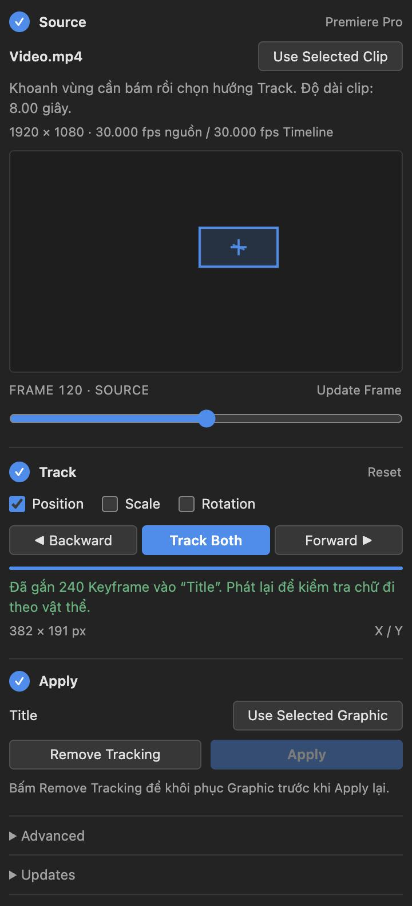

<div align="center">

# PR Track 2D

**Motion tracking 2D ngay trong Adobe Premiere Pro.**
Khoanh một vùng trên video, bấm Track, rồi gắn Text hoặc Graphic chạy theo vật thể.

[](https://github.com/evolvestudiowork-gif/pr-track-2d/releases/latest)
[](https://github.com/evolvestudiowork-gif/pr-track-2d/releases)


[**Tải bản mới nhất**](https://github.com/evolvestudiowork-gif/pr-track-2d/releases/latest) · [Có gì mới](CHANGELOG.md) · [Báo lỗi](https://github.com/evolvestudiowork-gif/pr-track-2d/issues)



</div>

## Tính năng

- **Track hai chiều từ một Frame bất kỳ.** Chọn vùng ở giữa clip, plugin tự Track ngược về đầu và tiến tới cuối.
- **Position, Scale, Rotation.** Bật riêng từng thuộc tính hoặc kết hợp.
- **Không mất dấu giữa chừng.** Khi vật thể bị che hay mờ, plugin dự đoán vị trí và đánh dấu các Frame đó là **Estimated** để bạn kiểm tra lại.
- **Gỡ được.** **Remove Tracking** xóa Keyframe vừa Apply và trả Graphic về như cũ.
- **Giao diện như panel gốc.** Ba bước Source → Track → Apply, màu và cỡ chữ theo Premiere.
- **Chạy hoàn toàn trên máy.** Không cần cài Python hay OpenCV, không gửi video đi đâu.

## Cài đặt

### 1. Tải đúng gói

Vào [trang Release mới nhất](https://github.com/evolvestudiowork-gif/pr-track-2d/releases/latest), mục **Assets**:

| Máy của bạn | Tải file |
| --- | --- |
| Windows 64-bit | `PR-Track-2D-<phiên bản>-Windows-Standalone.zip` |
| Mac Apple Silicon (M1, M2, M3, M4…) | `PR-Track-2D-<phiên bản>-macOS-arm64-Standalone.zip` |
| Mac Intel | `PR-Track-2D-<phiên bản>-macOS-x86_64-Standalone.zip` |

Không tải **Source code (zip)** — gói đó không có bộ cài.

### 2. Cho phép extension chưa ký số (chỉ làm một lần)

PR Track 2D đang ở dạng beta, chưa được Adobe ký số, nên Premiere cần được cho phép chạy extension loại này. Đóng Premiere rồi chạy lệnh sau:

<details>
<summary><b>Windows</b> — mở <i>Command Prompt</i> và chạy</summary>

```bat
reg add "HKCU\Software\Adobe\CSXS.12" /v PlayerDebugMode /t REG_SZ /d 1 /f
```

</details>

<details>
<summary><b>macOS</b> — mở <i>Terminal</i> và chạy</summary>

```sh
defaults write com.adobe.CSXS.12 PlayerDebugMode 1
```

</details>

Bộ cài chỉ kiểm tra thiết lập này, không tự thay đổi nó.

### 3. Chạy bộ cài

1. Giải nén **toàn bộ** file ZIP vào một thư mục (không chạy thẳng bên trong ZIP).
2. Đóng Premiere.
3. Chạy **`Install-PRTrack.cmd`** (Windows) hoặc **`Install-PRTrack.command`** (macOS).
4. Mở Premiere → **Window → Extensions → PR Track 2D**.

Cài bản mới cũng làm y hệt; bản cũ được thay tự động.

## Sử dụng

**1 · Source**
Chọn video trên Timeline, đặt Playhead ở một Frame thấy rõ vật thể, bấm **Use Selected Clip**.

**2 · Track**
Kéo chuột khoanh một vùng có nhiều chi tiết trên Preview. Chọn **Position / Scale / Rotation**, rồi bấm **Track Both** (hoặc **Backward** / **Forward** nếu chỉ cần một chiều). Kéo thanh trượt bên dưới Preview để xem lại; nút **Xem Frame Estimated** nhảy tới các Frame được dự đoán.

**3 · Apply**
Tạo Text / Graphic, đặt Playhead ở một Frame bất kỳ trong đoạn đã Track rồi đặt chữ vào đúng chỗ trên vật thể. **Giữ nguyên Playhead ở Frame đó**, chọn Graphic trên Timeline, bấm **Use Selected Graphic** rồi **Apply**: Graphic giữ đúng vị trí tại Frame đang đứng và chạy theo vật thể ở các Frame còn lại. Phát lại để kiểm tra; không ưng thì bấm **Remove Tracking**.

Muốn khoanh lại vùng khác: bấm **Reset** ở bước Track. Source, Graphic và các thiết lập được giữ nguyên.

### Mẹo để Track tốt hơn

- Khoanh vùng có góc cạnh, hoa văn hoặc chữ rõ nét; tránh vùng trơn hoặc lấy quá nhiều nền.
- Vùng nhỏ vừa đủ bao vật thể thường bám tốt hơn vùng lớn.
- Nếu Playhead nằm ngoài đoạn Graphic và đoạn đã Track trùng nhau, plugin lấy Frame mốc làm chuẩn (hoặc Frame đầu tiên trùng nhau nếu Graphic không phủ Frame mốc).
- Caption cần chuyển thành Graphic trước khi Apply.
- Video quay dọc bằng điện thoại dùng trực tiếp được. Nếu plugin báo codec không seek chính xác (điện thoại hay quay frame rate thay đổi), xuất lại clip với frame rate cố định rồi Track.

## Giới hạn

- Chỉ chuyển động 2D: chưa hỗ trợ Perspective, biến dạng hay 3D.
- Video cần tốc độ Frame cố định, pixel vuông, tốc độ phát 100%. Clip đã dùng speed ramp, Warp Stabilizer hoặc Scale to Frame Size cần xuất thành video trước.
- Bật **Scale** cần Graphic có **Uniform Scale**. Thuộc tính được chọn để Apply phải chưa có Keyframe.
- Scale/Rotation xoay quanh **Anchor Point của Graphic**, không quanh điểm được Track như khi Parent vào Null trong After Effects.
- **Stop** hủy lượt Track đang chạy; phần đã chạy chưa dùng để Apply được.
- **Remove Tracking** chỉ nhớ lần Apply gần nhất trong lúc panel còn mở.

## Câu hỏi thường gặp

<details>
<summary><b>Không thấy PR Track 2D trong Window → Extensions</b></summary>

Kiểm tra lại bước 2 (cho phép extension chưa ký số), rồi khởi động lại Premiere. PR Track 2D hỗ trợ Premiere Pro 2026 (26.x) và 2027 (27.x).

</details>

<details>
<summary><b>macOS báo không mở được bộ cài hoặc engine</b></summary>

Bản Mac chưa được Apple công chứng (notarization). Mở <b>System Settings → Privacy & Security</b> và chọn <b>Open Anyway</b> cho file bị chặn. Đảm bảo đã tải đúng gói arm64 hay x86_64 theo máy.

</details>

<details>
<summary><b>Vùng chọn chạy lệch khỏi vật thể</b></summary>

Xem các Frame <b>Estimated</b> (khung màu vàng) — đó là vị trí dự đoán khi mất dấu. Thử khoanh vùng nhỏ hơn, rõ chi tiết hơn, hoặc chọn Frame mốc ở đoạn vật thể rõ nhất rồi Track lại.

</details>

<details>
<summary><b>Làm sao cập nhật?</b></summary>

Panel tự kiểm tra bản mới mỗi lần mở (mục <b>Updates</b>). Khi có bản mới, bấm nút để mở trang Release, tải ZIP và chạy lại bộ cài. Tracking không cần mạng; mạng chỉ dùng để kiểm tra cập nhật.

</details>

## Báo lỗi và góp ý

Tạo [Issue](https://github.com/evolvestudiowork-gif/pr-track-2d/issues) kèm:

- phiên bản PR Track 2D (mục **Updates**) và Premiere,
- Windows hay macOS,
- thông báo lỗi và các bước dẫn tới lỗi,
- nếu được: ảnh vùng đã khoanh hoặc một đoạn video ngắn.

## Dành cho người phát triển

Panel CEP (HTML/JS + ExtendScript) gọi một engine Python/OpenCV đóng gói sẵn. Cách build, kiểm thử và phát hành: xem [GITHUB-RELEASES.md](GITHUB-RELEASES.md) và [README-macOS.md](README-macOS.md).

```sh
npm ci
npm run check && npm run lint && npm test && npm run test:engine
```
